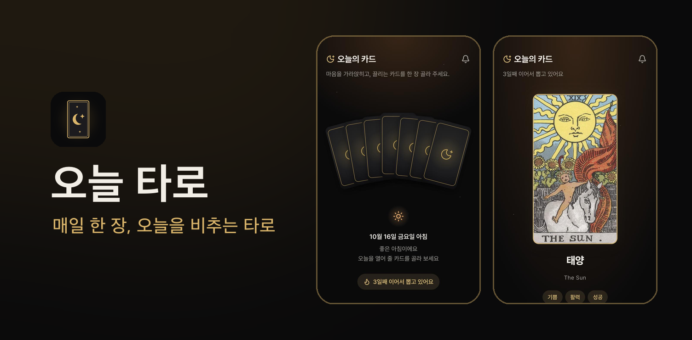
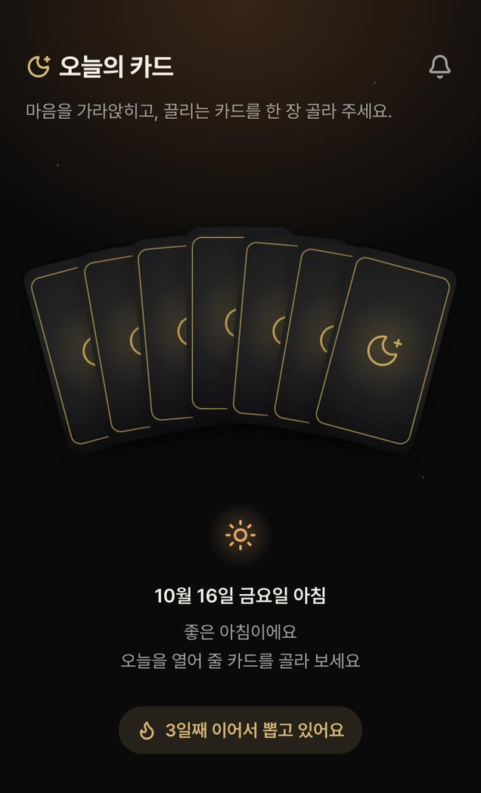
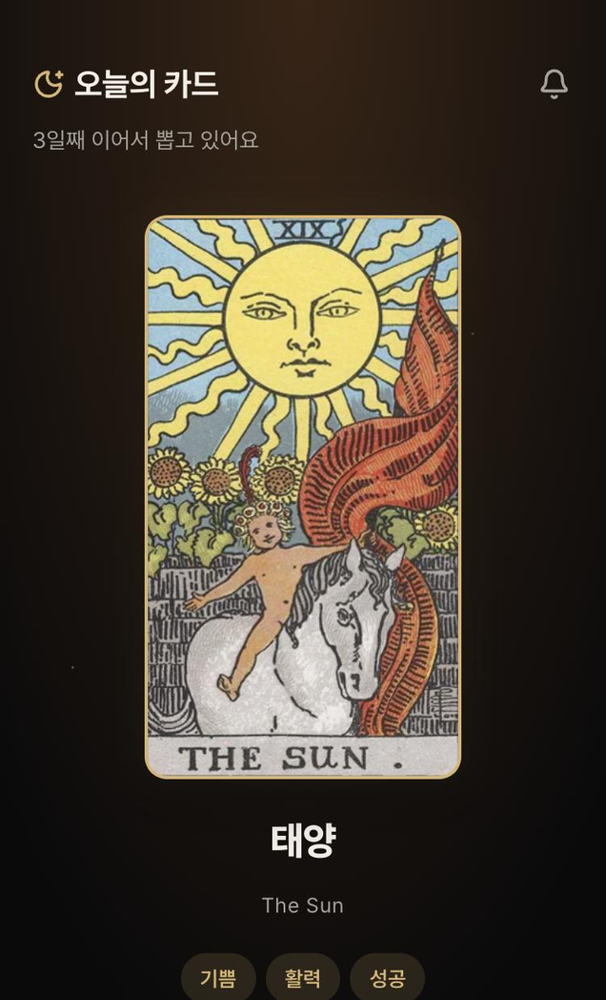
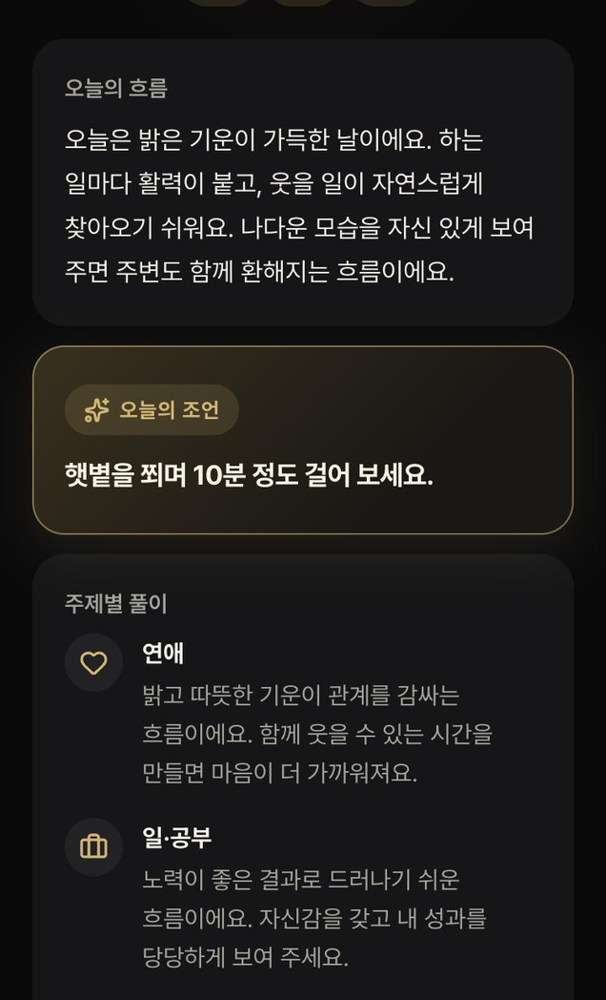
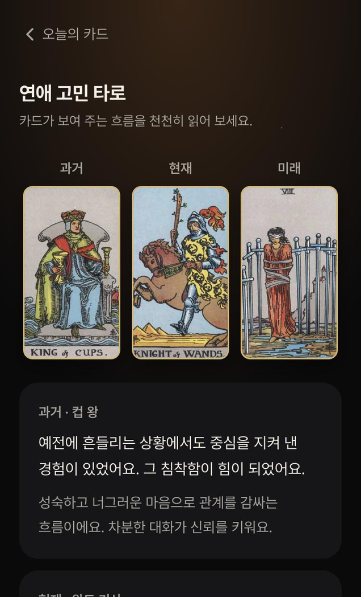

<div align="center">


# 오늘 타로

**매일 한 장, 오늘을 비추는 타로**

토스 앱 안에서 바로 쓰는 하루 한 장 타로 미니앱

</div>

<p align="center">
  
</p>

## 이런 앱이에요

아침마다 펼쳐진 카드 중 마음이 가는 한 장을 골라 보세요.
카드가 뒤집히면 오늘의 흐름과 조언, 연애·일·금전·인간관계 풀이를 알려드려요.
고민이 있는 날에는 카드 3장으로 과거, 현재, 미래의 흐름을 읽어 볼 수 있어요.

## 주요 기능

<table>
  <tr>
    <td align="center" width="25%">
      <br />
      <b>카드 고르기</b><br />
      <sub>펼쳐진 7장 중 끌리는 카드를<br />한 장 골라요. 하루에 한 번이에요</sub>
    </td>
    <td align="center" width="25%">
      <br />
      <b>오늘의 카드</b><br />
      <sub>카드가 뒤집히며 이름과<br />키워드를 보여줘요</sub>
    </td>
    <td align="center" width="25%">
      <br />
      <b>카드 풀이</b><br />
      <sub>오늘의 흐름과 조언, 주제별 풀이,<br />카드 속 상징까지 읽어요</sub>
    </td>
    <td align="center" width="25%">
      <br />
      <b>고민 타로</b><br />
      <sub>주제를 고르고 3장으로<br />과거·현재·미래를 읽어요</sub>
    </td>
  </tr>
</table>

**그리고**
- 78장 타로카드 모두에 전통 해석을 바탕으로 한 풀이
- 시간대에 맞춰 바뀌는 인사와 연속 기록
- 매일 오전 8시 30분 카드 알림
- 로그인 없이 바로 시작, 기록은 기기에만 저장

## 이렇게 써요

1. 앱을 열고 펼쳐진 카드 중 한 장을 골라 '이 카드로 할게요'를 눌러요.
2. 뒤집힌 카드의 오늘의 흐름과 조언을 읽어요.
3. 고민이 있으면 결과 아래에서 주제를 골라 카드 3장을 뽑아요.
4. 내일 아침 알림을 받고 새 카드를 뽑아요.

---

## 개발

토스 [앱인토스](https://developers-apps-in-toss.toss.im/) WebView 미니앱이에요.

| 구분 | 사용 기술 |
|---|---|
| 프레임워크 | React 18, TypeScript, Vite |
| 디자인 | TDS(토스 디자인 시스템), Pretendard, lucide-react |
| 앱인토스 SDK | `@apps-in-toss/web-framework` (Storage, 인앱 광고, 공유, 알림 동의) |
| 데이터 검증 | zod |
| 테스트 | vitest |

### 시작하기

```bash
npm install
npm run dev
```

### 테스트

```bash
npm test
```

카드 78장의 풀이가 비어 있지 않은지, 검수에 걸릴 단어가 없는지, 카드 그림이 다 있는지도 테스트로 확인해요.

### 빌드하고 배포하기

```bash
npm run build
npm run deploy
```

`npm run build`를 하면 콘솔에 올릴 `onul-tarot.ait` 파일이 만들어져요.
배포 API 키는 [앱인토스 콘솔](https://apps-in-toss.toss.im/) → 워크스페이스 → API 키에서 발급받아요.

### 출시 전 설정

| 파일 | 할 일 |
|---|---|
| `src/config/ads.ts` | 콘솔에서 발급한 광고 그룹 ID(배너, 리워드)로 교체 |
| `src/config/notification.ts` | 푸시 템플릿 검수 후 받은 발송 코드 입력 (비어 있으면 알림 안내를 숨겨요) |

### 화면 주소

| 주소 | 화면 |
|---|---|
| `intoss://onul-tarot` | 오늘의 카드 |
| `intoss://onul-tarot/spread` | 고민 타로 |

### 카드 그림

`src/assets/cards/<카드 id>.webp` 파일을 자동으로 불러와요. 예: `major-0.webp`(바보), `cups-14.webp`(컵 왕).
그림이 없는 카드는 검정·금색 기본 카드로 보여줘요.

### 폴더 구조

```text
src/
├── content/      # 카드 78장 풀이, 카드 목록, 카드 그림 연결 (테스트 포함)
├── domain/       # 카드 뽑기, 연속 기록, 시간대, 저장 데이터 계산 (테스트 포함)
├── pages/        # 오늘의 카드, 고민 타로 화면
├── components/   # 카드, 부채꼴 카드 고르기, 풀이, 바텀시트 등
├── hooks/        # 상태 저장, 화면 이동, 광고, 날짜
├── platform/     # 앱인토스 SDK 연결 (저장소, 공유, 알림)
├── assets/cards/ # 카드 그림 (webp)
└── config/       # 광고 ID, 알림 발송 코드
assets/
├── icon/         # 앱 아이콘 (콘솔 등록용 600x600)
└── screenshots/  # 콘솔 등록용 스크린샷
```

### 유용한 링크

- [앱인토스 콘솔](https://apps-in-toss.toss.im/)
- [앱인토스 개발자센터](https://developers-apps-in-toss.toss.im/)
- [앱인토스 개발자 커뮤니티](https://techchat-apps-in-toss.toss.im/)
